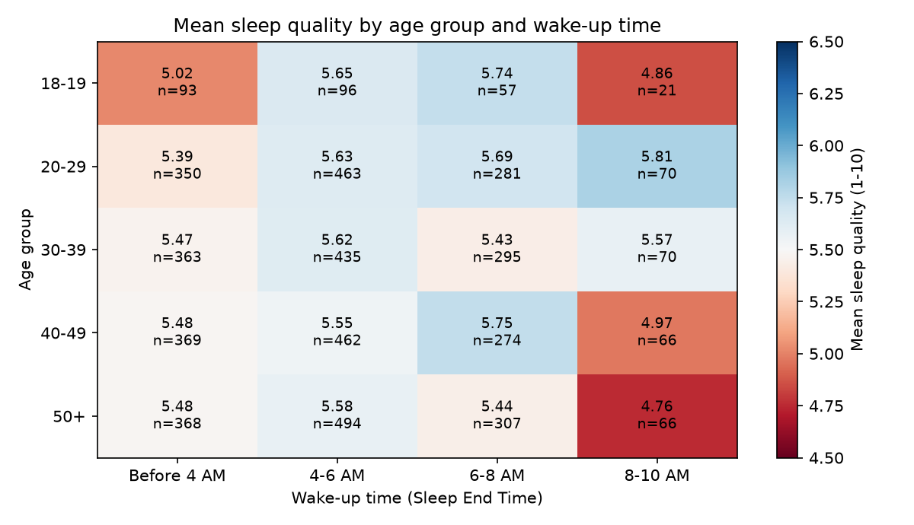
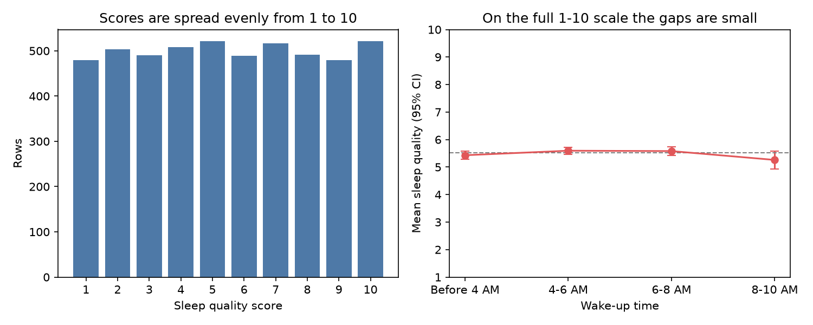

# Sleep Quality vs Wake-Up Time and Age

A Tableau analysis of whether the time people wake up, and their age, relate to how well they sleep, built on a 5,000-row sleep and productivity dataset. After building the dashboard, I checked the patterns statistically in Python and found they don't hold up. The data turned out to be synthetic, and the write-up explains how to tell.

**Skills shown:** Tableau (calculated fields, heatmaps, box plots, highlight actions) · exploratory data analysis · binning and segmentation · Python (pandas, matplotlib) · permutation testing · sanity-checking a dataset before drawing conclusions

---

## 📌 At a glance

| | |
|---|---|
| **Question** | Does wake-up time affect sleep quality, and does that differ by age group? |
| **Data** | 5,000 sleep records for 3,858 people across 2024, 15 columns ([`data/`](data/)) |
| **Tools** | Tableau for the dashboard, Python for the statistical check |
| **Result** | The dashboard shows gaps of up to one point between groups, but none of them is statistically significant, and sleep quality has no correlation (\|r\| < 0.02) with any other column |
| **Context** | My part of a five-person final project: the team built one Tableau story, and each member owned one question |



---

## ❓ Question and approach

The team's project asked how sleep habits relate to productivity and well-being. My question was the wake-up side of it: **do people who wake up at different times sleep better or worse, and is that the same for every age?**

In Tableau I created two calculated fields to segment the data:

```
// Formatted Sleep End Time
IF [Sleep End Time] < 4 THEN "Before 4 AM"
ELSEIF [Sleep End Time] < 6 THEN "4-6 AM"
ELSEIF [Sleep End Time] < 8 THEN "6-8 AM"
ELSEIF [Sleep End Time] < 10 THEN "8-10 AM"
ELSE "After 10 AM" END

// Age Group: 18-19, 20-29, 30-39, 40-49, 50+
```

and built four linked views on one dashboard:

| View | What it shows |
|---|---|
| Line chart | Mean sleep quality by wake-up time, one line per age group |
| Heatmap | Age group × wake-up time, coloured by sleep quality |
| Box plot | Distribution of sleep quality within each age group |
| Bar chart | How wake-up times are distributed in each age group |

Selecting a mark in one view highlights the same age group and wake-up time in the others (a dashboard highlight action).

---

## 📊 What the dashboard shows

- **Waking between 4 and 8 AM** goes with the highest average sleep quality (≈ 5.6 out of 10). Waking **before 4 AM** (5.43) or **after 8 AM** (5.26) is lower.
- **Age groups look almost the same** overall, from 5.39 (18-19) to 5.58 (20-29). The box plots overlap almost completely.
- **The largest gaps are in small cells.** For example, 18-19 year olds waking at 8-10 AM average 4.86, but that cell holds only 21 people.

---

## 🔍 Do the patterns hold up?

Before turning these into recommendations, I checked them in Python ([`analysis/check_patterns.py`](analysis/check_patterns.py)) using the same bins as the Tableau fields.



| Check | Result | What it means |
|---|---|---|
| Permutation test, wake-up time (5,000 shuffles) | p = 0.12 | Gaps this size appear often by chance |
| Permutation test, age group | p = 0.81 | No age effect |
| Correlation of sleep quality with every other column | all \|r\| < 0.02 | Not even total sleep hours or stress relate to it |
| Distribution of sleep quality | 480–521 rows for each score from 1 to 10 | Almost perfectly uniform, unlike real survey data |

**Conclusion:** the dataset is almost certainly synthetic, with sleep quality generated independently of the other columns. The patterns in the dashboard are noise, so they shouldn't drive any recommendation. With real data, the same dashboard and checks would show whether the 4–8 AM pattern is genuine.

**What I'd take from this:** a clean-looking chart isn't evidence by itself. Checking sample sizes per cell, testing gaps against chance and looking at the raw distribution should come before drawing a conclusion.

---

## 🗂 Repository

```
data/
└── sleep_cycle_productivity.csv                 source data (5,000 rows)
tableau/
└── sleep-quality-vs-wake-time-and-age.twbx      my dashboard, data packaged in
analysis/
└── check_patterns.py                            statistical check and README figures
docs/
├── heatmap_age_wake.png
└── reality_check.png
```

## ▶️ How to explore it

- **Tableau dashboard:** open `tableau/sleep-quality-vs-wake-time-and-age.twbx` in Tableau Desktop or the free [Tableau Public](https://public.tableau.com/app/learn/how-to-videos) app. The data is packaged inside the workbook.
- **Statistical check:**

  ```bash
  pip install -r requirements.txt
  python analysis/check_patterns.py
  ```

  It prints the tables and test results above and regenerates the figures in `docs/`.

## 🧭 Limitations

- The data appears to be synthetic, so no real-world conclusion can be drawn from it.
- Wake-up times run from 12:30 AM to 9:30 AM, so the "After 10 AM" bin is empty. Very early wake-ups reflect sleep start times between 8 PM and midnight.
- The figures in this README are recreated in Python from the same data and bins as the Tableau views.

## 💻 Tech stack

Tableau · Python · pandas · NumPy · matplotlib
